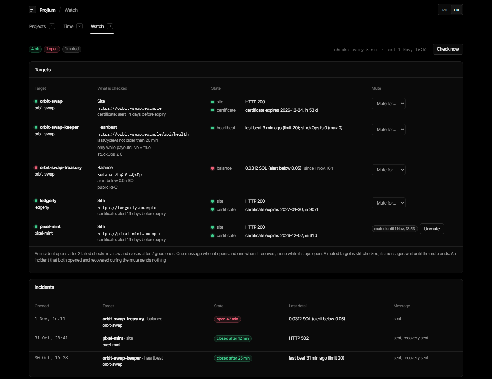

# Projium

A local dashboard over your project notes, for builders who ship client projects with AI agents and keep a Markdown note per project (Obsidian or any folder of `.md` files). It reads your notes where they are, in your own layout, field names and status words.


It reads your cards and the project repos and shows, per project:

- stage, next step, open tasks with due dates and priorities, updates, timeline;
- time from spec to design pick, first push and mainnet, with medians across projects, a chart of build time by start date and a per-project breakdown by phase;
- whether the last readiness audit still matches the code (commits and uncommitted files after the audited commit);
- uptime of the live site and which feature flags are on in prod;
- where the build time went, from Claude Code transcripts: Claude working, review, waiting for you, pauses (only timestamps and event kinds are kept; message text is never stored or shown).

The list starts with what needs you: overdue and p1 tasks, deadlines in the next two days, sites that are down. Press `/` to search, sort by urgency, or switch to a dense table.

You can edit card fields and tasks from the dashboard, including tasks your agents wrote without a Projium id, and check off updates. It writes one field or one line at a time and never overwrites something you changed in Obsidian meanwhile: it shows what is there now and asks.

Optional: a daily digest to Telegram (or any command you name), and **Launch Watch** for what is live: sites and their certificates, a keeper heartbeat, low wallet balances (Solana, EVM), with one alert when an incident opens and one when it recovers, an incident history and muting for maintenance ([docs/watch.md](docs/watch.md)).




## Set it up in 5 minutes

You need [Node.js](https://nodejs.org) 24 or newer and git. No packages to install. Run:

```
npx github:egorb2302/Projium
```

It asks three things and suggests an answer for each:

1. Where your project notes are. It lists the folders of your Obsidian vaults that hold notes with a status, or takes any folder of `.md` files. It reads your notes and shows how it understood them: the layout, the field that holds the status, your status words as Projium stages (you can correct each), the heading of your to-do list.
2. Where you clone project repos. It lists folders that hold git repos.
3. Your time zone (this computer's by default).

Then it writes the config to `~/.projium/tracker.config.json`, starts the dashboard in the background and opens it in your browser. Nothing in your notes is changed. If the folder has no projects yet, it offers to create a first card.

Run the same command again to open the dashboard; `npx github:egorb2302/Projium stop` stops it, `... restart` restarts it, `... doctor` checks the setup. `--help` lists the options, including `--notes`, `--repos` and `--yes` to set up without questions.

To keep Projium in a folder of its own (for autostart, or to update it with `git pull`), clone it and run the same setup there; the config then lives in that folder:

```
git clone https://github.com/egorb2302/Projium.git
cd Projium
npm run setup
```

Afterwards, everything else is in the dashboard:

- **Settings** (key `4`): the notes, repos and transcripts folders, the time zone, the digest time, language and channel (a Telegram bot or a command), the port and the Launch Watch targets. Each save is checked like the config file itself and written atomically; the previous version is kept next to it (`.bak-<time>`, the last 10). Restart Projium to apply it (the page says how).
- **New project** on the list: creates a card in your notes folder from [the card template](docs/card-template.md), in your own layout, field names and status words. It never overwrites an existing note.
- **From repos** in the same panel: lists the git repos in your repos folder that no card points at, and creates a card for each one you tick.

## Let your AI agent set it up

Paste this to Claude Code, Codex or any agent that can run commands on your computer:

```
Install Projium (https://github.com/egorb2302/Projium) on this computer and connect it
to my project notes. Follow AGENTS.md in the repo step by step and finish when
npm run --silent doctor reports ok and the server is running. Ask me before you
edit or create any notes, add a token or a site to check, or set up autostart.
```

The agent reads [AGENTS.md](AGENTS.md): how to find your projects and map your notes to cards, `init` to write the config, `doctor` for a JSON check that says exactly what is missing, and `start:bg` / `stop` to run the server in the background. Afterwards your agents can read and update projects through an [MCP server](docs/mcp.md) (Claude Code, Codex, Claude Desktop, Cursor; `node scripts/mcp.mjs --check` prints the registration commands) or the [local API](docs/api.md). We test it by giving fresh agents only this repo and a sample vault that was not written for Projium (one with a note per client in a flat folder and its own status words, one with a folder per project, mismatched note names and repos named in prose). In the latest runs both set it up through the config alone in a few minutes, with repos matched, and the vaults were left byte-for-byte unchanged.

## Run it by hand

```
git clone https://github.com/egorb2302/Projium.git
cd Projium
npm start
```

Open http://127.0.0.1:3210. With no config file you see four demo projects from `demo/`; `npm run setup`, or the Settings page, points it at your own notes.

`npm run start:bg` starts it in the background and `npm run stop` stops it; `npm run start:bg -- --open` also opens it in the browser. On Windows, double-clicking `start-tracker.cmd` does the same.

## Point it at your projects

```
npm run --silent init -- --projects "C:/path/to/Projects" --repos "C:/path/to/code" --offset=+03:00
npm run --silent doctor
```

`init` writes `tracker.config.json` (git-ignored) from flags, for scripts and agents; `npm run setup` asks instead. `doctor` prints a JSON report of what is shown, what is skipped and why, and exits 0 once the setup is complete. Use the `--offset=` form: `--offset=-05:00` works, `--offset -05:00` does not. You can also copy `tracker.config.example.json` and edit it by hand ([schema](tracker.config.schema.json)). Relative paths resolve from the config file's folder; `~` is your home folder.

| Key | Default | Meaning |
|---|---|---|
| `projectsDir` | `demo/projects` | Folder with one subfolder per project, holding `<name>/<name>.md`. |
| `reposDir` | `demo/repos` | Where the project repos are cloned; a repo is matched by folder name unless the card says otherwise. |
| `transcriptsDir` | `~/.claude/projects` | Claude Code transcripts, for the time split. |
| `port` | `3210` | `PORT` in `.env.local` or the environment wins. |
| `utcOffset` | your computer's at start | Time zone of the times written in cards and of the digest day, as `+03:00`. Set it explicitly if your zone has daylight saving time. |
| `readinessFile` | `READINESS.md` | Name of the readiness file next to each card. |
| `ignore` | `[]` | Words, matched case-insensitively. For a project whose name or repo path contains one, the repo, its transcripts and its site are never touched; the card itself is still listed. Matched against the full repo path, so avoid words that appear in `reposDir`. |
| `reviewAgents` | `["code-reviewer"]` | Claude Code subagent types counted as review time. |
| `digest.at` | `10:00` | Local time of the daily digest. |
| `digest.lang` | `en` | `en` or `ru`. |
| `digest.command` | none | Command that sends the digest; the text is passed as the last argument. Overrides Telegram. |
| `digest.env` | `[]` | Names of environment variables that command needs (for example `["SLACK_BOT_TOKEN"]`). `npm run start:bg` passes the server only system variables, Projium's own and these. |
| `streak.repo` | none | A git clone the server commits a dated line to once a day and pushes. Leave it out unless you want that. |
| `cards` | folder layout, Projium names | How notes are found and read: `layout` (`folder` or `flat`), `recursive`, `filter`, `name` (file, folder or title), `fields` (Projium field → your key, `null` to turn a field off), `stages` (your words → Projium stages), `sections` (your tasks heading), `repos` (project → repo folder). See [docs/card-format.md](docs/card-format.md). |

Your notes in another shape, for example one note per client with `status: in progress` and a `## Todo` list:

```json
"cards": {
  "layout": "flat",
  "filter": { "type": "client-project" },
  "fields": { "stage": "status", "spec_at": "started" },
  "stages": { "in progress": "development", "waiting for client review": "review", "shipped": "done" },
  "sections": { "tasks": "Todo" }
}
```

`npm run --silent survey -- --dir <folder>` lists the keys, values and checkbox headings your notes use, to write this mapping from.

The card format, the readiness file and the optional repo conventions are in [docs/card-format.md](docs/card-format.md); a card to copy is in [docs/card-template.md](docs/card-template.md).

### Telegram digest

Enter a bot token and your chat id on the Settings page, or put them into `.env.local` next to the config (git-ignored), and restart:

```
TELEGRAM_BOT_TOKEN=123456:ABC...
TELEGRAM_CHAT_ID=123456789
```

The digest lists projects in progress, next steps, urgent tasks, sites that are down, stale audits and overdue tasks in closed projects. If the computer was asleep at the set time, it goes out within a minute of waking, for that day only. If sending fails (no network, Telegram unreachable), it tries again after 15 minutes, 30 minutes, an hour, then every two hours, ten tries a day at most; each failure is logged with its reason (with `npm run start:bg`, in `server.err.log` next to the database, `data/` by default). Preview it without sending at http://127.0.0.1:3210/api/digest.

## Privacy and safety

- The server listens on 127.0.0.1 only and checks the Host and Origin headers, so other machines and web pages cannot reach it.
- Network calls: the `site` URLs of your cards (uptime and `/api/config`), the Launch Watch targets you list in the config (sites, heartbeat URLs, and a JSON-RPC balance call per wallet), and, if you set one, the digest and alert channel. Site and watch checks refuse names that resolve to private, loopback or link-local addresses, do not follow redirects and do not read page bodies (the config and heartbeat reads are capped at 512 KB). The digest carries project names, next steps and tasks from your cards, and alerts carry target names and what failed; nothing else leaves the computer. A keyed RPC URL is read from an environment variable you name and is never shown, logged or stored.
- The API returns only the documented card fields, repo folder names instead of paths, and file system errors by code, so a key you keep in a card's frontmatter or a local path does not reach the browser or the digest. The one exception is the Settings page, which shows the folders and the config file path you set; it never shows the Telegram token or an RPC URL. Digest command and git failures are reported by exit code, never by their output.
- New cards (New project, From repos, the first card in setup) are new files created only when they do not exist yet; Projium never overwrites or renames a note.
- Transcript parsing keeps timestamps and event kinds only. Message text is read in memory for three fixed checks and is never stored or returned; a test asserts a planted secret does not reach the API.
- Images are served only from inside `projectsDir` (and the repo's own `public/og.*`); symlinks and junctions that lead outside are not followed. Git is read with `--no-optional-locks` and never fetched or written, except the opt-in `streak` repo.
- Local state lives in `data/tracker.db`: uptime history, the digest log, Launch Watch state, incidents and mutes, and the build-time intervals read from transcripts (start, end and kind of each stretch, keyed by the repo path and the transcript's file name and size; no message text). Those intervals are kept when the Claude app deletes a transcript, so a deleted session still counts.
- Writes into your notes are checked twice: line by line, and by parsing the frontmatter as YAML before and after. A write is refused unless every other key reads exactly as before and the field holds exactly the new value. Frontmatter that does not parse, or hides a key inside another value, makes the card read-only.

## Tests

```
npm test
```

## Limits

- Built and used daily on Windows; macOS and Linux should work but are less tested.
- Restart the server after pulling new code; what changed is in [CHANGELOG.md](CHANGELOG.md).
- Started with `npx`, Projium runs from npm's cache: autostart (`npm run --silent autostart`) needs a clone.
- One computer only: reach it from a phone through your own tunnel (for example Tailscale) if you need to.

## License

MIT, see [LICENSE](LICENSE). Fonts in `public/fonts` are under the SIL Open Font License (texts included). `lib/vendor/js-yaml.mjs` is [js-yaml](https://github.com/nodeca/js-yaml) 4.1.1, MIT ([license](lib/vendor/js-yaml.LICENSE)).
