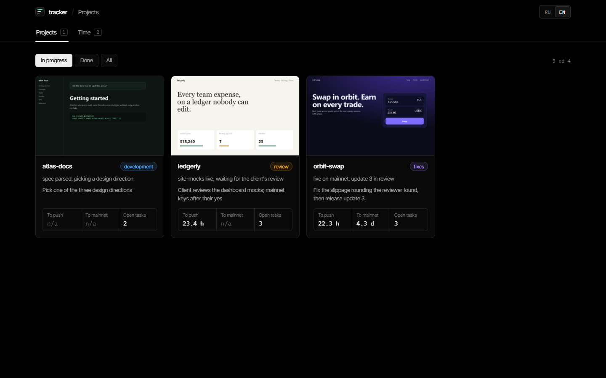
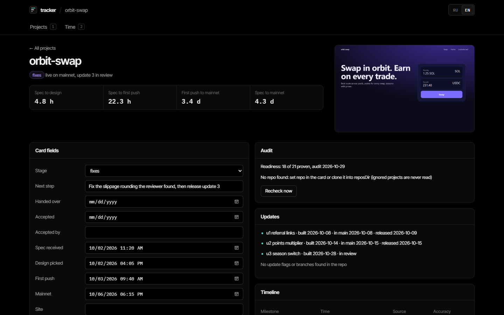

# vibe-tracker

A local dashboard over your project notes, for builders who ship client projects with AI agents and keep a Markdown card per project (Obsidian or any folder of `.md` files).



It reads your cards and the project repos and shows, per project:

- stage, next step, open tasks with due dates and priorities, updates, timeline;
- time from spec to design pick, first push and mainnet, with medians across projects;
- whether the last readiness audit still matches the code (commits and uncommitted files after the audited commit);
- uptime of the live site and which feature flags are on in prod;
- where the build time went, from Claude Code transcripts: Claude working, review, waiting for you, pauses (timestamps only, no message text).

You can edit card fields and tasks from the dashboard. It writes one field or one task line at a time and never overwrites something you changed in Obsidian meanwhile: it shows what is there now and asks.

Optional: a daily digest to Telegram (or any command you name).



## Run it

You need [Node.js](https://nodejs.org) 24 or newer and git. No packages to install.

```
git clone https://github.com/<owner>/vibe-tracker.git
cd vibe-tracker
npm start
```

Open http://127.0.0.1:3210. With no config file you see four demo projects from `demo/`.

On Windows, `start-tracker.cmd` starts the server if it is not running and opens the browser (it assumes the default port 3210).

## Point it at your projects

Copy `tracker.config.example.json` to `tracker.config.json` and edit it. The file is git-ignored. Relative paths resolve from the config file's folder; `~` is your home folder.

| Key | Default | Meaning |
|---|---|---|
| `projectsDir` | `demo/projects` | Folder with one subfolder per project, holding `<name>/<name>.md`. |
| `reposDir` | `demo/repos` | Where the project repos are cloned; a repo is matched by folder name unless the card says otherwise. |
| `transcriptsDir` | `~/.claude/projects` | Claude Code transcripts, for the time split. |
| `port` | `3210` | `PORT` in `.env.local` or the environment wins. |
| `utcOffset` | your computer's at start | Time zone of the times written in cards and of the digest day, as `+03:00`. Set it explicitly if your zone has daylight saving time. |
| `readinessFile` | `READINESS.md` | Name of the readiness file next to each card. |
| `ignore` | `[]` | Words, matched case-insensitively. For a project whose name or repo path contains one, the repo, its transcripts and its site are never touched; the card itself is still listed. Matched against the full repo path, so avoid words that appear in `reposDir`. |
| `reviewAgents` | `["code-reviewer"]` | Claude Code subagent types counted as review time. |
| `digest.at` | `10:00` | Local time of the daily digest. |
| `digest.lang` | `en` | `en` or `ru`. |
| `digest.command` | none | Command that sends the digest; the text is passed as the last argument. Overrides Telegram. |
| `streak.repo` | none | A git clone the server commits a dated line to once a day and pushes. Leave it out unless you want that. |

The card format, the readiness file and the optional repo conventions are in [docs/card-format.md](docs/card-format.md).

### Telegram digest

Put a bot token and your chat id into `.env.local` (git-ignored) and restart:

```
TELEGRAM_BOT_TOKEN=123456:ABC...
TELEGRAM_CHAT_ID=123456789
```

The digest lists projects in progress, next steps, urgent tasks, sites that are down, stale audits and overdue tasks in closed projects. If the computer was asleep at the set time, it goes out within a minute of waking, for that day only. Preview it without sending at http://127.0.0.1:3210/api/digest.

## Privacy and safety

- The server listens on 127.0.0.1 only and checks the Host and Origin headers, so other machines and web pages cannot reach it.
- Network calls: the `site` URLs of your cards (uptime and `/api/config`) and, if you set one, the digest channel. Site checks refuse names that resolve to private, loopback or link-local addresses, do not follow redirects and do not read page bodies (the config read is capped at 512 KB). The digest carries project names, next steps and tasks from your cards; nothing else leaves the computer.
- The API returns only the documented card fields, repo folder names instead of paths, and file system errors by code, so a key you keep in a card's frontmatter or a local path does not reach the browser or the digest. Digest command and git failures are reported by exit code, never by their output.
- Transcript parsing keeps timestamps and event kinds only. Message text is read in memory for three fixed checks and is never stored or returned; a test asserts a planted secret does not reach the API.
- Images are served only from inside `projectsDir` (and the repo's own `public/og.*`); symlinks and junctions that lead outside are not followed. Git is read with `--no-optional-locks` and never fetched or written, except the opt-in `streak` repo.
- Local state (uptime history, digest log) lives in `data/tracker.db`.

## Tests

```
npm test
```

## Limits

- Built and used daily on Windows; macOS and Linux should work but are less tested.
- Restart the server after pulling new code.
- One computer only: reach it from a phone through your own tunnel (for example Tailscale) if you need to.

## License

MIT, see [LICENSE](LICENSE). Fonts in `public/fonts` are under the SIL Open Font License (texts included).
